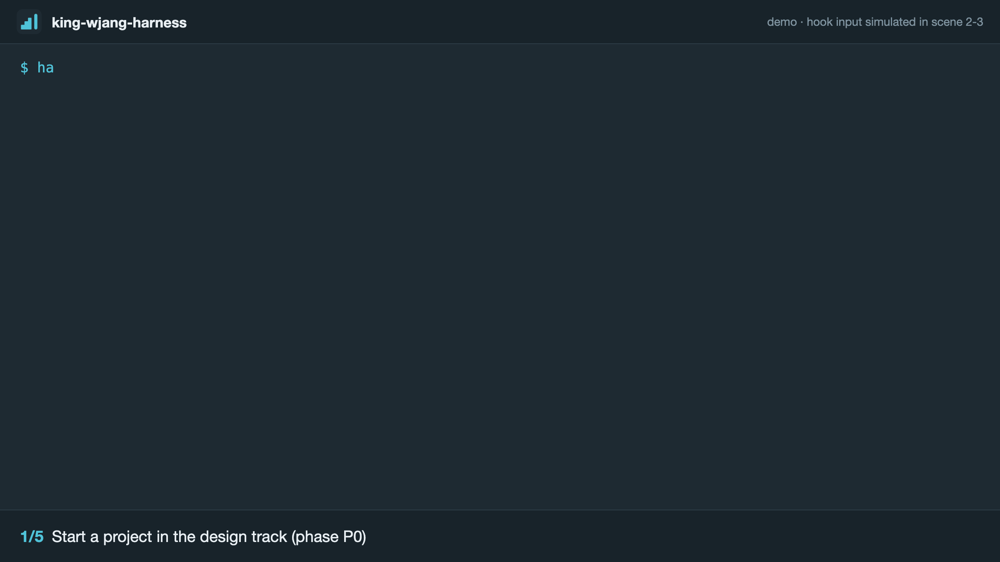
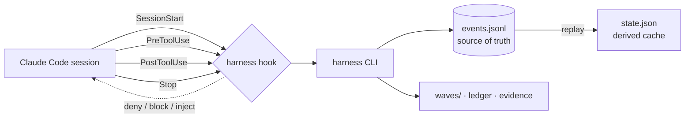

<!-- LANG-SWITCH -->
[English](README.md) · **한국어** · [日本語](README.ja.md) · [中文](README.zh.md)

# king-wjang-harness

> **AI 에이전트는 어떤 지시든 그럴듯한 핑계를 대고 건너뛴다. 하지만 훅은 핑계로 건너뛸 수 없다.**

AI 코딩 에이전트가 작업 절차를 지키게 하는 도구다. **프롬프트로 권고하지 않고, 훅으로 강제한다.** king-wjang-harness는 **설계 → 구축 → 출하** 순서를 에이전트가 건너뛸 수 없게 만든다. 에이전트가 설계 단계에서 소스 코드를 쓰려 하거나, 정산하지 않은 작업을 남긴 채 세션을 끝내려 하면 **도구 호출 자체를 거부**한다. 설득하지도 않고, "잊지 말고 해 주세요"라고 부탁하지도 않는다. 판정은 **모델 바깥에서, 같은 입력이면 늘 같은 결과를 내는 게이트**가 한다.

<sub>훅 + CLI · 기준 기록은 추가만 하는(append-only) 이벤트 저널 · 세션당 컨텍스트 ~260 토큰 · 켜지 않은 프로젝트에서는 아무것도 출력하지 않음</sub>



---

## 30초 요약

모든 팀이 AI 에이전트에게 작업 절차를 가르친다. *설계부터 하고, 테스트를 쓰고, 끝내기 전에 작업을 정산하라.* 이 규칙을 `CLAUDE.md`, 스킬, 시스템 프롬프트에 적어 둔다.

그런데 압박을 받으면 모델은 **스스로를 설득해 규칙을 건너뛴다**: *"이건 간단하니 설계 문서는 건너뛰자."* *"수동으로 이미 테스트했잖아."* 지시는 권고일 뿐이라서, 따를지 말지는 모델이 정한다. 자기 사건을 스스로 판결하는 판사와 같다.

**지시를 더 잘 써도 강제의 문제는 풀리지 않는다.** 그래서 모델이 통제하지 못하는 게이트가 필요하다.

king-wjang-harness가 그 게이트다. 에이전트가 **설계 트랙**에서 `src/app.ts`를 편집하려 하면 `PreToolUse` 훅이 `deny`를 반환하고, 편집은 실행되지 않는다. 커밋하지 않은 작업이 있는데 턴 로그 없이 세션을 끝내려 하면 `Stop` 훅이 `block`을 반환한다. 모델이 무엇이라고 해도 이 반환값은 바뀌지 않는다.

---

## 스킬 vs. 훅 — 무엇이 다른가

비교할 기준은 "어느 도구가 빠른가"가 아니다. **규율이 스택의 어느 층에서 동작하는가**다.

| | 프롬프트 / 스킬 / `CLAUDE.md` <br>*(권고)* | **king-wjang-harness** <br>*(강제)* |
|---|---|---|
| **메커니즘** | 모델이 읽고 *따를지 선택*하는 텍스트 | 훅이 `deny` / `block` 을 반환한다 — 결정은 모델 **바깥**에서 한다 |
| **모델이 무시 가능?** | 예 — 압박을 받으면 핑계를 대고 건너뛴다 | **아니오** — 도구 호출 자체가 차단된다 |
| **부하 시 신뢰도** | 가장 필요한 순간에 지켜지지 않는다 | 일정하다 — 훅의 판정은 작업량이나 상황에 따라 달라지지 않는다 |
| **컨텍스트 비용** | 규칙을 더할수록 커진다 | **세션당 ~260 토큰 고정** — 규칙이 프로세스 밖에서 실행되므로 규칙을 더해도 늘지 않는다 |
| **실패 양상** | 모르는 사이에 규칙에서 벗어나고, 나중에야 발견된다 | 관측할 수 있다 — 건너뛴 일마다 기록이 남는다 |
| **상태** | 상태가 없어 세션마다 다시 설명해야 한다 | 이벤트 저널에 남아 `/clear`·재개·머신 교체 뒤에도 유지된다 |

> **경쟁 관계가 아니라 서로 보완한다.** [superpowers](https://github.com/obra/superpowers) 같은 스킬 라이브러리는 모델이 *일을 더 잘하게* 돕는다. king-wjang-harness는 *절차 자체를 건너뛸 수 없게* 만든다. 그래서 둘을 함께 쓰는 것이 좋다. 스킬은 방법을 제안하고, 훅은 지켰는지 판정한다.
>
> `king-wjang-harness` 드라이버 스킬은 **이 동반 플러그인(companion)이 설치돼 있는지 확인하고 빠진 것을 설치한다**. 설치는 네트워크를 쓰는 작업이라 일반 Bash 권한 확인을 거치고, 알려진 마켓플레이스에서만 받는다. 동반 플러그인은 필수가 아니다. 없어도 훅은 절차를 강제한다.

**아래는 한 번씩 돌려 본 결과이고 벤치마크가 아니다.** 조건마다 1회씩만 돌렸고, 방법(모델·과제 원문·시행 수)을 기록해 두지 않았다. 그러니 측정값이 아니라 사례로 읽어야 한다. 두 에이전트에게 같은 과제(하네스를 처음 구성한 뒤 UX 증적 게이트를 통과해 웨이브를 완료하기)를 주었다:
- **하네스 안내 없이** → 에이전트가 증적 게이트에 막히자 우회 플래그를 추측으로 이것저것 시도했고, 결국 **작업을 끝내지 못했다.**
- **안내와 함께** → 모든 단계를 마쳤고, 게이트에 막혔을 때도 올바른 방법으로 다시 진행했다.

결과를 가른 것은 게이트다. 안내만으로는 통과하지 못하고, 강제된 계약이 있어야 통과한다.

---

## 동작 방식



- **이벤트 저널이 기준 기록이다.** `.harness/events.jsonl`에는 기록을 추가만 한다(append-only). `state.json`은 저널에서 만든 *파생 캐시*라서, 손상되거나 지워지면 하네스가 저널을 다시 읽어 재구성한다. `harness doctor --repair`가 이 일을 한다.
- **세 트랙, 열세 페이즈.** 설계 `P0–P6` · 구축 `P7–P9` · 출하 `P10–P12`.
- **훅 5종, 바이너리 하나:**
  - `SessionStart` — 현재 페이즈, 활성 웨이브, 웨이브 지시서, 최근 턴 로그, 손상 경고를 주입한다. 그래서 에이전트는 세션을 시작할 때 지금 어디까지 왔는지 정확히 안다.
  - `PreToolUse` — 설계 트랙에서는 소스 쓰기와 배포성 Bash 명령을 거부한다. 그리고 **모든** 페이즈에서 하네스가 관리하는 파일 3개를 손으로 고치는 것을 거부한다.
  - `PostToolUse` — 실제 작업(쓰기, 하네스 자신을 부르지 않는 Bash)이 일어났다고 기록한다. Stop 가드는 이 기록을 보고 정산할 턴이 있는지 판단한다.
  - `UserPromptExpansion` — 사용자가 `/king-wjang-harness:approve <P>` 를 입력하면 승인에 쓸 표를 낸다.
  - `Stop` — 활성 웨이브에서 작업이 있었는데 턴 로그가 갱신되지 않았으면 세션 종료를 막는다. ("사소한 턴이었다"고 명시한 한 줄을 남기면 종료할 수 있다.)
- **웨이브 & 설계 원장.** *웨이브*는 턴 로그와 수용 기준을 가진 작업 단위다. *원장*에는 버전이 붙은 설계 노드를 담는다. `node bump`는 바뀐 설계를 참조한 모든 웨이브에 **STALE**을 전파한다. 그래서 낡은 결정 위에 모르는 사이에 작업이 쌓이지 않는다.

---

## 디자인 시스템 & Claude Design 🎨

하네스는 **디자인을 강제하고 버전으로 관리하는 상태**로 다룬다. Claude Design은 그 상태를 화면으로 보고 고치는 도구다. 일부는 지금 동작하고, 더 깊은 연동은 다음 마일스톤이다. 아래에서 둘을 나눠 적는다.

### 오늘(v0): UX 증적 게이트

`UX-` 노드를 참조하는 웨이브는 `.harness/evidence/<wave-id>/`에 **시각 산출물이 없으면 완료할 수 없다.** Claude Design에서 프롬프트로 목업을 만들어 HTML/PNG로 내보내고 증적 폴더에 넣으면 게이트가 열린다. 따라서 **실제로 그려 본 적 없는 UX 기능은 출하할 수 없다.**

### Claude Design 연동 — 캔버스 가져오기는 P4 스킬이 맡는다

*(이 절의 제목은 원래 「로드맵」이었다. 그런데 이 제목은 실제보다 적게 말하는 쪽으로 틀렸다. 아래 내용은 전부 구현되고 실측돼 있다. 캔버스 가져오기는 코어에 없는데, 강제 훅을 로컬에서만 돌리려는 «의도된» 설계다. 대신 P4 스킬이 WebFetch 로 캔버스를 받아 코어에 넘긴다. 실제보다 적게 알리는 것도 문서 결함이다. 다만 그런 결함에는 아무도 항의하지 않을 뿐이다.)*

- **캔버스가 시각 정본이다.** 아트보드 하나가 UX 노드 하나에 대응하고(`"UX-7 결제"`), 캔버스 URL은 설계 원장에 기록된다. **코어**는 강제 훅을 로컬에서 빠르게 돌리려고 캔버스를 네트워크로 가져오지 않는다. 그 일은 **P4 스킬**이 맡는다. P4 스킬은 WebFetch 로 캔버스를 받아 `harness design sync <UX-x> --from <파일>` 로 넘기는 일을 한 흐름으로 처리한다. 그래서 캔버스는 에이전트가 가져오고, 코어는 로컬에서만 동작한다.
- **`harness design sync`** 는 캔버스를 가져와 승인 때의 해시와 대조한다. 바뀌었으면 **노드 version을 올리고 → STALE을 전파한다.** 그래서 캔버스를 고치면 *정식 설계 개정*이 되고, 그 설계를 참조하는 모든 구축 웨이브에 자동으로 표시가 붙는다.
- **P4 추출** 은 컴포넌트 목록과 2× 기준 PNG를 캡처한다. 이 캡처는 나중에 화면이 달라졌는지 검토할 때 쓴다.
- **피드백 루프:** `harness gate feedback` 이 캔버스의 코멘트 스레드를 개정 사항으로 모은다. 그래서 아이패드에서 채팅 없이 "검토 → 코멘트 → 개정 → 재제출"을 반복할 수 있다.

### 디자인 시스템 규율: 토큰 파일 하나가 톤을 정한다

**불변식: 제품의 시각적 톤 전체가 토큰 파일 하나로 정해진다.**

- 기능 코드에는 raw 값을 쓰지 않고 시맨틱 토큰만 쓴다. `text.primary` ✅ · `blue.500` ❌.
- 원천은 `design-tokens.json` 하나다. CSS 변수·TS 상수·Tailwind config는 전부 이 파일에서 만든 *생성물*이라 손으로 복제하지 않는다.
- 디자인 시스템은 4계층(토큰 → 프리미티브 → 기본 컴포넌트 → 도메인 컴포넌트)이다. 계층마다 `DS-*` 원장 노드가 있고, 승인한 뒤에는 디렉토리를 **동결**해 컴포넌트가 함부로 늘지 않게 한다.
- **3중 강제**(훅 계층은 **기본 off** — `config.yaml` 에서 켠다)**:** 린트(raw 값이 있으면 CI 실패) + 훅(토큰 파일 밖에서 색·간격 값을 직접 쓰는 편집을 거부) + **토큰 스왑 드릴**(테마를 바꾼 뒤 모든 화면을 캡처한다. 값을 직접 박은 화면만 바뀌지 않아서 바로 드러난다).

> 이 불변식이 지켜지면 **파일 하나만 고쳐 제품 전체의 테마를 바꿀 수 있다.** 그리고 이것을 약속이 아니라 스크린샷 드릴로 증명한다.

---

## 보증 (실제로 지키는 불변식)

- **비간섭** — `.harness/` 디렉토리가 *없는* 프로젝트에서는 모든 훅이 아무것도 반환하지 않는다. 출력도, 파일도, 컨텍스트 토큰도 없다. 드는 것은 **시간**뿐이다. 셸 게이트가 Node를 띄우기 전에 **p95 ~4ms** 안에 끝낸다. 그래서 전역으로 설치해도 위험이 없고, 훅은 **프로젝트마다** `harness init` 을 실행한 뒤에만 켜진다.
- **무해** — 훅은 **어떤 경우에도 세션을 중단시키지 않는다.** 내부 실패는 모두 기록한 뒤 `exit 0`으로 끝낸다. 판정 중에 오류가 나면 훅은 아무것도 반환하지 않을 뿐이고, 세션은 계속된다.
- **결정성** — 어떤 판정 경로에도 현재 시각이나 난수를 쓰지 않는다. 그래서 같은 입력이면 실행할 때마다 같은 판정이 나온다. (같은 테스트를 3회 실행해 확인했다.)
- **관측 가능한 fail-open** — 하네스가 오류 때문에 판정 없이 통과시킬 때는 `.harness/.runtime/hook-errors.log`에 기록을 남긴다. `harness doctor`는 그 줄 수를 세어 보여 준다. 기록이 남지 않는 fail-open은 없는 것만 못하기 때문이다.
- **주입 방어** — 웨이브 frontmatter와 턴 로그 본문은 *이전* 세션이 쓴 것이라 믿을 수 없는 입력으로 다룬다. 그래서 지시로 주입하기 전에 무해하게 바꾼다. 개행을 무력화하고 제어문자를 지우며, 발췌문은 내용 해시로 만든 nonce 펜스로 감싼다. 이렇게 하면 위조된 로그가 펜스를 벗어나 하네스 지시처럼 보이게 할 수 없다.
- **런타임 자체완결** — 빌드본 `core/dist/`가 커밋돼 있어서 클론만 하면 빌드 없이 동작한다. `yaml`은 번들 안에 포함했고(그 ISC 고지도 번들 «안»에 함께 넣었다), 런타임 진입점이 참조하는 외부 모듈은 Node 내장 모듈뿐이다. `npm audit --omit=dev`: **취약점 0.** (범위: `claude plugin install` 은 플러그인 캐시에서 `npm ci --ignore-scripts` 를 실행한다. 이 리포는 `omit=dev` 를 적은 `.npmrc` 를 함께 배포하므로 개발 도구는 더 이상 내려받지 않는다. 실측하면 버전당 **1.3MB·10패키지**다(이전 약 81MB). 배포본에 실린 테스트를 직접 돌려 보려면 `npm install --include=dev` 로 개발 의존성을 설치한다.)

### 실측

| 지표 | 값 |
|---|---|
| 훅 지연 (p95) | 두 가지로 재며 **둘 다 `npm run bench:hook` 이 출력한다**. *인프로세스*(번들이 이미 메모리에 올라온 상태에서 판정에 걸린 시간): 정상 **0.9 ms**, 10만 건(15 MB) 저널을 다시 읽는 폴백 중 **18.6 ms**. *wall-time*(도구 호출이 실제로 기다리는 시간), 같은 실행에서: **77 ms** / **102 ms**. 그중 **40 ms 는 그 머신에서 `node` 를 띄우는 시간**이다. wall-time 절대값은 머신마다 다르므로, 게이트는 폴백이 **더하는 시간**으로 판정한다(인프로세스 +17.7 ms · wall-time +24.7 ms · 문턱 50 ms). |
| 테스트 스위트 | **1665 tests** (69 파일) — **배포본에서 1658건 통과**(나머지는 배포본에 들어가지 않는 리포 내부 문서를 검사한다. `git archive` 로 실측). 시간을 단언하는 시험 2건은 머신이 바쁠 때 판정하지 않고 **「측정 불가」와 그때의 부하**를 기록한다 |
| 세션당 추가 컨텍스트 | 하네스가 켜졌을 때 **~260 토큰** · `.harness/` 없는 프로젝트는 **0**. 다시 재려면: `echo '{"hook_event_name":"SessionStart"}' \| ./bin/harness-hook session-start \| wc -c` — 주입되는 브리핑은 ~1KB 다(프로젝트 경로가 들어가므로 정확한 크기는 조금씩 다르다). 바이트 수를 4로 나누면 토큰 수 추정치가 된다 |
| 런타임 의존성 | **1** (`yaml`, 번들) |
| 결정성 | 3회 실행해도 판정이 같다 |

**직접 다시 재 볼 수 있다** — `npm run bench:hook` 이 패키지에 함께 들어 있다. 이 스크립트는 10만 건 저널을 세 부류
(현실·손상·적대)로 합성해 **두 가지를 모두** 잰다. 하나는 인프로세스 판정이고, 다른 하나는 실제 훅 프로세스다.
그리고 **이 머신에서 `node` 를 띄우는 데 드는 최소 시간**도 함께 출력한다.
절대값의 큰 부분은 이 도구가 아니라 `node` 기동 시간이기 때문이다.

---

## 누구를 위한 것인가

- *코드보다 설계 먼저*를 적어 두는 데 그치지 않고 실제로 지키고 싶은 팀.
- 에이전트가 테스트 실행·작업 정산·기록을 "잊는" 일에 지친 사람.
- 시각 증적과 함께 출하해야 하는 UX 작업. 하네스는 시각 증적이 있어야 웨이브 완료를 허용한다.
- **세션 핸드오프**가 중요한 장기 프로젝트. 진행 기록이 저널에 남아 있어서, 새 세션(또는 다른 머신)이 직전 세션이 멈춘 곳부터 정확히 이어 간다.

---

## 빠른 시작

### 설치 (Claude Code 플러그인으로) — Node.js 18 이상

```bash
claude plugin marketplace add wook8170/king-wjang-harness
claude plugin install king-wjang-harness@king-wjang-harness
```

플러그인이 훅 5종을 자동으로 연결한다. `core/dist/`가 커밋돼 있어서 클론만으로 동작한다 — **빌드 단계가 필요 없다.**

<details>
<summary>또는 소스에서 (개발)</summary>

```bash
npm install --include=dev   # 설치자용으로 .npmrc 가 dev 를 빼므로 명시한다. prepare 훅이 core/dist 빌드
./bin/harness --version
```
</details>

### 사용법 — 사용자 자리에서

**대부분은 평소처럼 프롬프트만 입력하면 된다.** 하네스는 에이전트를 *통해* 동작한다. CLI는 에이전트가 대신 실행하고, 규칙은 훅이 강제한다. 그래서 명령을 외울 필요가 없다.

```
당신:   "로그인 기능 만들자."
에이전트: (설계 트랙 P0 확인) 설계 노드 등록, 웨이브 생성, 설계 문서 작성 —
         하지만 아직 src/는 못 건드림(훅이 거부).
         "설계 초안 나왔습니다. 봐주세요."
당신:   "좋아, 구축 진행해."
에이전트: 구축 트랙으로 넘어가 src/ 구현, 끝내기 전 턴 로그 정산.
```

사용자가 직접 할 일은 **결정 지점**에 있다. 설계를 승인하고, 설계에서 구축으로 넘어갈 시점을 정한다. *어떻게* 할지(CLI 실행과 규칙 준수)는 에이전트와 훅이 맡는다.

> 터미널과 Claude 데스크톱 앱에서 똑같이 동작한다. 같은 엔진과 같은 훅을 쓰기 때문이다.

### 명령 레퍼런스

**`harness` 는 어디 있나.** CLI 는 플러그인에 함께 들어 있다. Claude Code 는 플러그인의
`bin/` 을 **에이전트가 명령을 실행하는 셸의 PATH** 에 추가한다. 그래서 그 셸에서는 아래 표의 명령이 적힌
그대로 동작하고, 이 명령들도 보통 그 셸에서 실행된다. 다만 사용자 본인의 터미널 PATH 에는 이 항목이
없다. 직접 실행하려면 설치된 플러그인의 `bin/` 을 PATH 에 추가한다:

```bash
export PATH="$(ls -d "$HOME"/.claude/plugins/cache/king-wjang-harness/king-wjang-harness/*/bin | tail -1):$PATH"
harness --version
```

| 명령 | 하는 일 |
|---|---|
| `harness init` | `.harness/` 상태 저장소를 만든다 (이때부터 훅이 켜진다) |
| `harness status` | 현재 상태를 JSON 으로 출력한다 |
| `harness phase set <P0..P12>` | 페이즈를 전환한다 — **게이트가 승인돼야 다음 페이즈로 넘어간다** |
| `harness node upsert --id <id> --title <t> [--status …]` | 설계 원장의 노드를 만들거나 갱신한다(upsert) |
| `harness node bump <id>` | 노드를 개정한다 → `version++`, 이 노드를 참조하는 웨이브에 STALE 전파 |
| `harness wave create --goal <g> [--milestone m] [--refs a,b] [--accept c]` | 웨이브를 만들고 id 를 출력한다 (`--goal` 필수) |
| `harness wave activate <wave-id>` | 웨이브를 활성화한다 |
| `harness wave update "<한 일 / 다음>"` | 턴 로그를 정산한다 |
| `harness wave complete` | 웨이브를 완료한다 (UX 노드를 참조하는 웨이브는 시각 증적이 필요하다) |
| `harness backtrack <phase> --reason "…"` | 나중 트랙에서 공식 절차를 밟아 설계로 되돌아간다 |
| `harness doctor [--repair [--force]] [--accept-policy]` | 무결성을 검사한다 · 저널을 다시 읽어 복구한다 · 정책 변경을 찾는다 (`--accept-policy` 는 `HARNESS_ACCEPT_POLICY=1` 이 필요하며 사람만 쓴다) |
| `harness gate submit <P0..P12>` | 해당 페이즈의 산출물을 검토에 올린다 |
| `/king-wjang-harness:approve <P0..P12>` · `harness gate approve <P0..P12>` | **사람만** 한다 — 다음 페이즈로 넘어가는 승인이다. [게이트 승인](#게이트-승인) 참고(허용목록에 넣지 않는다) |
| `harness report denials [--limit <n>]` | 훅이 최근에 거부한 도구 호출과 그 이유를 보여 준다 |
| `harness loop critical raise --reason <r> [--detail <d>]` · `harness loop critical clear` | 사람에게 판단을 요청하고 웨이브 루프를 멈춘다. 판단이 끝나면 해제한다 |

`harness --help`는 전체 명령 목록을, `harness <군> --help`는 그 명령군의 하위명령을 보여 준다. 이 표는 짧은 요약이다. 훅 이벤트(`harness hook …`)는 플러그인이 호출하므로 직접 입력할 일이 없다.

### 게이트 승인

승인은 사용자의 판단이다. 방법은 셋이고, 판 번호가 든 경로를 칠 일은 없다.

| 방법 | 사용자가 하는 일 | 저널 기록 |
|---|---|---|
| 슬래시 명령 | Claude Code 에 `/king-wjang-harness:approve <P>` 를 입력한다 | `via: slash` |
| 확인 창 | 에이전트가 `harness gate approve <P>` 를 한 줄 단독으로 실행하면 창에 답한다. 창에는 단계 · 산출물 · 근거 등급이 보인다 | `via: dialog` |
| 터미널 | 플러그인 `bin/` 이 `PATH` 에 있는 실제 터미널에서 `harness gate approve <P>` 를 실행한다 | `via: terminal` |

슬래시 명령은 `disable-model-invocation: true` 로 선언돼 있어 에이전트가 부르면 Claude Code 가 막는다.

다음 경우에는 사람에게 창이 뜬다고 보장할 수 없다. 그래서 훅이 창을 띄우지 않고 거부하며 슬래시 명령을 안내한다.

- 권한 모드가 `default` · `acceptEdits` · `auto` 가 아닐 때. `bypassPermissions` · `dontAsk` · `plan` 이 여기 든다.
- `-p` · SDK 세션이거나 서브에이전트의 호출일 때.
- 명령을 묶거나 파이프 · 치환 · 경로 · 환경 변수 접두를 붙였을 때.
- 설정의 `permissions.allow` 규칙이 `harness gate approve` 를 덮을 때. `harness doctor` 도 경고한다.

사람만 쓰는 다른 명령(`phase set --force` · `doctor --accept-policy`)은 Claude Code 프롬프트에서 `!` 를 붙여 실행한다. 예: `!harness loop critical clear`.

**해제하는 법.** `harness uninstall` 은 일부러 **두지 않았다**. 에이전트가 자기에게 적용되는
규칙을 스스로 끌 수 있으면 안 되기 때문이다. 해제는 사람이 자기 터미널에서 한다.

```bash
rm -rf .harness/          # 이 프로젝트 하나 — 훅이 즉시 조용해진다
```

이때 이벤트 저널도 함께 지워진다. 저널은 감사 기록이므로, 남기고 싶으면 먼저 복사해 둔다.
모든 프로젝트에서 끄려면 플러그인을 지운다(`claude plugin uninstall king-wjang-harness`).

**종료코드.** 릴리스 스크립트는 「제품이 준비되지 않았다」와 「명령이 아예 실행되지 않았다」를
구분할 수 있어야 한다. 그런데 예전에는 둘 다 exit `1` 이었다.

| 코드 | 뜻 |
|---|---|
| `0` | 성공 — 또는 판정이 「예」 |
| `1` | 사용법·환경 오류(하위명령 오타, 현재 위치에 `.harness/` 가 없음, 인자 누락) |
| `2` | **판정이 「아니오」** — `ship verdict` NO-GO · `doctor` 진단 실패 · `gate verify` 드리프트 · `evidence check` 미달 |

둘 다 0 이 아니므로 `cmd || exit 1` 스크립트는 예전처럼 멈춘다. 달라진 것은 **두 경우를 구분할 수 있게 된 것**뿐이다.

---

### MCP 도구 — 셸 없이 같은 엔진

플러그인은 MCP 서버도 등록한다. 그래서 에이전트는 `Bash` 대신 타입이 정해진 도구 호출로 하네스를 실행할 수 있다.
서버가 제공하는 도구는 정확히 16개다: `harness_status`,
`harness_wave_create`·`_activate`·`_update`·`_complete`·`_list`, `harness_node_upsert`·`_bump`,
`harness_gate_submit`·`_status`, `harness_report_rtm`·`_hub`, `harness_ship_verdict`,
`harness_trace`, `harness_doctor`. 그리고 `harness_gate_approve` 는 호출을 **거절하고 터미널에서 승인하라고 안내하는**
용도로만 있다.

**일부러 막아 둔 것 둘**: 게이트를 승인할 수 없고(최종 승인은 항상 사람이 한다 — 실수가 아니라 설계다),
승인되지 않은 게이트를 건너 페이즈를 옮길 수도 없다. MCP 로 할 수 있는 일은 CLI 로도 할 수 있던
일뿐이고, 같은 게이트를 거친다.

---

## 설정 — `.harness/config.yaml`

모든 키는 선택이고, 파일이 없으면 아래 기본값을 쓴다.
`design_*`·`block_raw_values` 네 키는 **훅이 무엇을 막을지 정하는 값**이다. 차단 규칙이 스택과 맞지
않으면 소스가 아니라 이 파일을 고친다.

| 키 | 기본값 | 하는 일 |
|---|---|---|
| `lang` | `en` | 하네스가 출력하는 문구의 언어 — CLI·훅 JSON·생성 문서에 적용된다. 한국어는 `ko` 이고, 한 번만 바꾸려면 `HARNESS_LANG=ko` 를 쓴다. **MCP 도구 설명·거절문·오류문은 영어로 남는다.** `lang: ko`·`HARNESS_LANG=ko` 를 모두 켜고 도구 목록, 게이트 승인 거절, 알 수 없는 도구·입력 오류까지 실측해 확인했다. |
| `profile` | `generic` | `test`·`build`·`deploy`·`e2e` 명령을 가져올 프로파일. 프로젝트 안의 `.harness/profile/` 이 번들 프로파일보다 **항상 우선**한다. |
| `remote_control` | `true` | SessionStart 에서 원격 제어 안내를 보여 줄지 정한다. |
| `terse` | `false` | 훅 안내를 짧게 줄인다. |
| `design_allowed_prefixes` | `['.harness/', 'docs/']` | **설계 트랙에서 구현 코드를 쓸 수 있는 곳.** 이 접두사 밖의 **소스 파일**은 P6 게이트 승인 전까지 거부된다. 설정·문서는 막히지 않고, **이름이 테스트인** 파일(`*.test.*`·`*_test.*`·`test_*`)도 막히지 않는다 — 다만 알아 둘 예외가 하나 있다: 프로파일이 선언한 소스 경로가 이름 규칙보다 **앞선다**. 그래서 `src/app.test.ts` 는 여전히 거부되고 `test/app.test.ts` 는 통과한다. |
| `design_blocked_bash` | 배포 명령들(`npm publish`·`docker push`·`terraform apply` …) | **출하 트랙이 열리기 전까지 막히는 배포성 명령.** 명령 안에 이 문자열이 들어 있기만 하면 걸리므로 뒤에 붙는 플래그는 적지 않는다. 스택별 명령은 프로파일의 `deploy_commands` 에 적는다. |
| `design_system_frozen_roots` | `[]` | 동결한 뒤에는 디자인 시스템 파일을 바꿀 수 없는 디렉토리. |
| `block_raw_values` | `false` | 시맨틱 토큰 대신 raw 색상·크기를 직접 쓰는 편집을 거부한다. |

`.harness/config.yaml` 자체도 보호 파일이다. 그래서 에이전트는 이 파일을 고쳐 자기 권한을 넓힐 수
없다([SEC-136]). 이 파일은 사람이 터미널에서 고친다. 고친 뒤에는 `harness doctor` 를 실행한다. 정책 변경은
저널에 기록되고, 변경을 받아들이려면 `HARNESS_ACCEPT_POLICY=1 harness doctor --accept-policy` 가 필요하다.

---

## 상태 — 프로덕션 검증 완료

**v0.1.2 — SHIP-READY.** 코어 엔진, 세 트랙, 열세 페이즈를 모두 구현하고 실측했다
(1665 tests). 그리고 하네스 **자신의** 출하 준비 게이트도 통과했다. 출하 규율을 강제하는 도구를
같은 규율로 검사해 통과시킨 것이다.

### 얼마나 검증했나

이 저장소에 `verifying-production-readiness` 감사를 **새로운 독립 컨텍스트**에서 실행했다.
감사자는 구현자와 다르다. 이 감사는 문서를 읽는 데 그치지 않고 **제품을 처음부터 끝까지 실제로 실행해 보는**
**11축** 점검이다. 결과는 다음과 같다:

- **출하 게이트 13개 → 12개 실측 PASS** (13번째인 훅 지연은 다른 작업이 없는 머신에서 다시 재면 통과한다):
  테스트 · 타입 · 자체완결 클론 · 훅 무해성 · 강제력 · MCP **안전 속성**(MCP 로는 게이트를
  승인할 수 없다) · 결정성 · 공급망(`npm audit --omit=dev`: **0**) ·
  비밀 이력(gitleaks, 커밋 307개: **0** — 이는 gitleaks 룰이 잡는 범위이고, GitHub 푸시 보호가 막는 범위와 다르다. 이 감사 중에 두 도구가 같은 문자열을 다르게 판정한 실례가 있었다) · CLI 계약 · 관측성 · 패키징.
- **훅 우회 적대적 점검 — 상시 300+ 항목 말뭉치 *바깥*의 새 표기 ~40개**를 모두 실제 훅에 넣어
  판정했다: 새로운 소스 쓰기 형태(`printf` · `dd` · `ex` · `install` · `python3 -c` ·
  `awk -i inplace` …), 코어 / 정책 / 저널 쓰기, 심링크·하드링크 TOCTOU, 저널 위조,
  `base64 -d | sh`, 중첩·배열 MCP 인자. **되돌릴 수 없는 대상인 코어·정책·상태·이벤트 저널에
  대한 쓰기는 전부 거부됐다. 「막으면 안 되는」 대조군에서는 과차단이 0건이었다.**
- **1665 tests green · `tsc` 0 · 반복 실행에서 결정적.**

**판정: SHIP-READY — 출하를 막는 결함 없음.** 일부러 열어 둔 빈틈 하나는 숨기지 않고 적어
둔다. 설계 단계에서 소스 쓰기를 막는 규칙은 *보안 벽이 아니라 과속방지턱*이다(「알려진 한계」와 FAQ 참조). 반면 뚫리면
되돌릴 수 없는 저널·정책 파일·코어는 벽으로 막는다.

> 이 감사는 이 플러그인이 동반 규율로 함께 제공하는 것과 같다. 하네스는 자기가 강제하는 규율을 스스로도 지킨다.
> 위 판정은 그 게이트를 하네스 자신에게 적용한 결과다.

### 무엇이 만들어져 있나

- ✅ 이벤트 저널, 상태 재생, doctor 복구
- ✅ 훅 5종: 세션 주입, 설계 트랙 거부, 활동 추적, 승인 명령 확인, stop 정산
- ✅ 웨이브 수명주기, STALE 전파 설계 원장, UX 증적 게이트
- ✅ 주입 방어, 비간섭·무해 불변식, 커밋된 자체완결 dist
- ✅ 승인 **게이트** (`gate submit/approve/verify/sweep/feedback`) + 산출물 레지스트리 (`doc`) + RTM (`report rtm`)
- ✅ **페이즈 스킬 — 열세 페이즈 전부** (P0–P12: 설계 `P0–P6`, 구축 `P7–P9`, 출하 `P10–P12`) + researcher / design-auditor / wave-executor / wave-verifier / readiness-auditor 에이전트 + ADR (`adr`) — 출하 전 UX 적대적 점검은 lanekeeper 플러그인(`lanekeeper:quality-ux-adversarial`)을 참조한다. P6 은 `HIGH 0` 이어야 P7 로 넘어간다(회차별 재감사, 반영 대조표, 인용 코드 대조). P10·P12 는 적대 검증 두 가지(구현 적합성 감사, 바뀐 화면 UX 적대 점검 — 9축·페르소나 과업 수행·디자인 시스템 시각 대조)를 필수 입력으로 받고, 둘 중 하나라도 열린 high 가 있으면 막는다
- ✅ **디자인 서브시스템** — `design link/sync/baseline/html`, 인터랙티브 HTML 정본, 토큰 파이프라인 (`tokens gen/lint/swap`)
- ✅ **구축·출하 트랙** — 스택 프로파일(`profile`), 웨이브 루프(`loop`), 시각 증적(`evidence`), 출하 대장·판정(`ship`)

### 알려진 한계

- **임의의 MCP 서버 스키마를 전부 알 수는 없다.** 이름이 쓰기를 뜻하는 도구(`write`·`edit`·`put` 등)는 판정하고 경로처럼 생긴 인자는 전부 검사한다. 그러나 도구 이름도 인자 이름도 그렇게 짓지 않은 서버는 훅이 판정할 수 없다.
- **밖에서 들어온 내용에는 명령문에 드러나지 않는 별칭이 들어 있을 수 있다.** 아카이브 안의 심링크는 판정 시점에 명령문에도 파일시스템에도 없어서, 훅이 원리상 볼 수 없다. 압축 해제·클론·설치 뒤 **새로 생길 경로**에 쓰는 것을 거부하던 규칙은 **되돌렸다**. 단어 하나로 우회됐고(`mkdir h && tar -xf a.tar -C h && echo x > h/f`), 평범한 단일 명령(`git clone <url> y && echo x > y/f`)까지 막았기 때문이다. 이 빈틈은 훅이 아니라 파일시스템 계층에서 막아야 한다.
- **이미 존재하는 하드링크는 코어 파일에 대해서만 검사한다.** 보호 파일의 새 이름을 만드는 것은 거부되고, `config.yaml`·`state.json`·`events.jsonl` 의 기존 앨리어스는 inode 로 찾아낸다. 하지만 하네스 설치 전에 만들어진 **소스 파일**의 앨리어스는 찾지 않는다. 모든 소스를 inode 로 대조하려면 쓰기마다 디렉토리를 훑어야 한다. 그러면 판정이 느려져 훅이 시간 초과되고, 시간 초과된 훅은 호출을 통과시킨다. (실측 · 아직 열려 있음)

- `verifying-production-readiness` 스킬은 **호출하지만 함께 배포하지 않는다** — 따로 설치해야 한다:
  `claude plugin marketplace add wook8170/verifying-production-readiness` 다음
  `claude plugin install verifying-production-readiness@verifying-production-readiness`.
- **레이아웃 템플릿 선언을 코어가 강제하지 않는다** — 디자인 시스템 검사는 토큰과 동결 경로만 본다.
- `/remote-control` 은 **이 플러그인이 제공하지 않는다** — 세션 안내는 지시가 아니라 조건부 안내다.
- 게이트가 재는 것은 **질이 아니라 양**이다. 산문이 아닌 것을 거부하고, 이미 심사된 게이트들이 보지 않은 텍스트를 80자 미만으로 가져오는 제출을 거부한다. 그래서 파일을 늘리거나, 한 글자만 바꾼 사본을 쓰거나, 승인된 묶음에 내용이 거의 없는 파일을 덧붙이는 방법은 모두 막혔다(실측 13/13 → 각각 0·1·2건 개통). 남은 것은 「새로 가져온 80자가 **좋은가**」이고, 그것은 사람이 판단한다. 리뷰 패킷은 제출된 경로와 크기를 모두 사람에게 보여 준다.
- **승인 경로는 호출자가 사람임을 증명하지 않는다.** 창의 응답은 Claude Code 가 받고 훅은 보지 못한다. 그래서 `via: dialog` 는 창 경로로 실행됐다는 기록이다. 창을 거절하면 어떤 훅 이벤트도 발생하지 않아 거절은 기록되지 않는다. 에이전트가 훅이 읽지 못하는 형태로 표 파일을 쓰거나 하위 대화형 세션을 조작하는 길은 남아 있다. Claude Code 2.1.319 실측에서 훅의 `ask` 는 `default` · `acceptEdits` · `auto` 에서 창을 띄웠다. 공식 문서도 `ask` 를 분류기가 판정하지 않는다고 적는다. Remote Control 은 재현하지 못했다.
- 사람이 `.harness/events.jsonl` 을 손으로 고치는 것은 **위협 모델 밖**이다 — 훅은 에이전트를 막는 장치이고, 저장소 주인을 막지는 않는다.
- 훅은 **해석할 수 있는 것까지** 본다. `sh -c`, 깊이 3까지의 스크립트, `npm run` 스크립트가 여기에 든다. **`make <타깃>` 은 해석하지 않는다**(Makefile 문법은 범위 밖). 깊이 4 이상으로 이어지는 스크립트는 따라가지 않고 **거부한다**. 마지막 단계가 무엇을 쓰는지 보지 못했다면 안전하다고 볼 수 없기 때문이다.
- **인터프리터에 «파일»로 넘긴 프로그램도 셸 스크립트와 같은 방식으로 읽는다** — `sed -f prog.sed`·`awk -f prog.awk`·`perl x.pl`·`python3 x.py`·`node x.js`·`bun`·`deno run`·`ruby`·`php`·`tclsh`·`lua`·`Rscript` 처럼 프로그램을 파일로 건네면 훅이 그 파일을 읽는다. 그 프로그램이 하네스 소유 경로에 쓰면 거부한다. **한계 셋은 의도적이다**: ① 프로그램 파일이 **64 KB 를 넘으면 거부가 아니라 건너뛴다**(실제 번들은 크고 손으로 쓴 위조본은 작다. 64 KB 넘는 위조본을 놓치는 것은 `node dist/cli.js` 를 막지 않으려고 감수하는 대가이며, 그래서 여기에 밝혀 둔다). ② **훅이 모르는 인터프리터**(`julia`·`groovy`·`raku` 같은 이색 런타임)는 열거 밖이다. ③ **경로를 리터럴로 쓰지 않고 언어 안에서 조립하는 프로그램** — 문자열 이어붙이기(`".har" + "ness/…"`)·`chr()`/`String.fromCharCode`·base64 — 은 리터럴 경로 검사에 안 걸린다(보호 디렉토리로 들어가는 상대 `chdir(".harness")` 는 걸린다). 드물게 쓰이는 인터프리터와 언어 내부의 난독화까지 완전히 막으려면, 훅이 본문을 읽는 방식으로는 부족하고 **파일시스템 계층의 강제**가 필요하다. 그것은 훅의 범위 밖이다.
- **저널 압축 명령은 의도적으로 두지 않는다.** `events.jsonl` 은 감사 기록이다. 그래서 이 파일을 다시 쓰는 명령은 **아무것도 지워서는 안 되는 곳에서 기록을 지우는 기능**이 된다. 압축 명령이 없어서 드는 비용에는 분명한 상한이 있다. 10만 건·15 MB(수십 년 분)를 다시 읽을 때 정상 경로에 더해지는 시간은 p95 +17.7 ms(인프로세스, wall-time 기준 +24.7 ms)다. 그나마 상태가 열화된 동안에만 들고, `doctor --repair` 를 실행하면 끝난다. **v0.2 가 더한 것은 압축이 아니라 상한이다**: 저널은 128 MB, 설계 원장과 지시서는 16 MB 를 넘으면 읽기를 거부하고 «직접 보관하라»고 안내한다. 그리고 `doctor` 는 상한의 절반에 이르면 미리 경고한다. 그래서 한계에 닿기 전에 알 수 있고, 감사 기록을 대신 지우는 일은 여전히 없다.

---

## FAQ

**느려지지 않나?** 훅의 판정 자체는 한 자릿수 밀리초 안에 끝나고, 규칙을 실제로 어길 때만 개입한다. 체감되는 시간은 머신이 `node` 를 띄우는 시간이고, 이 시간은 모든 Claude Code 훅에 똑같이 든다. 사소한 턴에는 stop 가드도 동작하지 않는다(활성 웨이브가 있을 때만 동작한다).

**차단에 동의하지 못하면?** 이 설계는 *벽이 아니라 과속방지턱*이다. Stop 가드는 "이 턴은 사소했다"고 명시한 보고를 받아 준다. 설계와 출하 사이의 경계는 공식 절차인 `backtrack`으로 넘는다. 훅은 보안 경계가 아니라 사고를 막는 장치다.

**내 다른 프로젝트를 건드리나?** 아니다. `.harness/` 가 없으면 모든 훅이 아무것도 하지 않는다. 프로젝트마다 직접 켜야 동작한다.

**`.harness/state.json`을 손으로 고쳐도 되나?** 안 된다 — 훅이 막는다. 기준 기록은 저널이라서, 손으로 고치면 상태가 저널과 어긋난다. `harness` 명령(또는 `harness doctor --repair`)을 쓴다.

## 실행하는 것 · 보내는 것 · 가져오는 것

### 실행하는 것

**훅**(`hooks/hooks.json`). 모든 훅은 짧은 `sh` 스크립트인 `bin/harness-hook` 을 부른다. 프로젝트에 `.harness` 가 없으면 이 스크립트는 바로 exit 0 으로 끝나고, 다른 것은 실행되지 않는다. `.harness` 가 있으면 Node.js 로 `bin/harness hook <이벤트>` 를 실행한다.

| 이벤트 | 대상 | 훅이 하는 일 |
|---|---|---|
| `SessionStart` | 전체 | 현재 페이즈·웨이브와 정산하지 않은 작업을 세션 맥락에 넣는다. `.harness/.runtime/` 에 남은 이전 세션의 활동 표시를 지운다 |
| `PreToolUse` | `Write`·`Edit`·`MultiEdit`·`NotebookEdit`·`Bash`, 이름이 쓰기처럼 보이는 MCP 도구 | 지금 페이즈가 허용하지 않는 쓰기를 거부한다. 설계 트랙에서 소스를 쓰는 경우가 그 예다. 판정에만 도구 입력을 읽고, 파일은 바꾸지 않는다 |
| `PostToolUse` | 위와 같다 | 파일을 바꿀 수 있는 도구였으면 `.harness/.runtime/last-activity` 에 시각을 적는다. `Stop` 훅은 이 기록을 보고 그 턴에 작업이 있었는지 판단한다 |
| `UserPromptExpansion` | `king-wjang-harness:approve` | 사용자가 승인 명령을 입력하면 짧게 유효한 표를 `.harness/.runtime/approve-ticket` 에 쓴다 |
| `Stop` | 전체 | 턴 기록을 정산하지 않았으면 세션 종료를 막고, 무엇을 정산할지 Claude 에게 알린다 |

훅은 `~/.claude/` 나 사용자 설정 파일, 권한 규칙을 고치지 않는다. 훅이 쓰는 곳은 프로젝트의 `.harness/.runtime/` 폴더뿐이다. 이벤트 저널 같은 나머지 `.harness/` 파일은 `harness` CLI 와 MCP 도구가 쓴다. 지우는 파일도 그 안에 있는 자체 임시 파일과 활동 표시뿐이다.

**MCP 서버** `harness`: `node ${CLAUDE_PLUGIN_ROOT}/mcp/server.js` 로 실행하는 로컬 stdio 서버다. 의존 패키지가 없다. 도구는 CLI 와 같은 `.harness/` 파일을 읽고 쓴다.

**CLI**: 플러그인이 켜져 있는 동안 `bin/harness` 가 Bash 도구의 `PATH` 에 들어간다. 사용자나 Claude 가 부를 때만 실행된다. 플러그인 최상위에 `bin/` 폴더가 있어서, 이 플러그인은 Claude Code 에만 설치되고 claude.ai 와 Cowork 에는 설치되지 않는다.

실제로 실행되는 코드는 `core/dist/cli.js` 와 `core/dist/mcp.js` 다. 둘 다 `core/src/` 를 압축하지 않고 묶은 파일이다. CI 는 새로 빌드한 결과가 이 두 파일과 한 바이트도 다르지 않은지 확인한다.

### 보내는 것

없다. 훅·CLI·MCP 서버는 네트워크 모듈을 불러오지 않고, 다른 프로그램도 실행하지 않는다. 플러그인은 데이터를 모으지 않고, 자체 서버도 없다. `harness migrate` 는 `~/.claude/` 아래에 예전 자작 훅 폴더가 있는지만 확인하고 안내 문구를 출력한다.

### 가져오는 것

플러그인 코드는 실행 중에 아무것도 내려받지 않는다. 네트워크를 쓰는 경우는 아래 세 가지이며, 모두 사용자 눈에 보인다.

- **설치.** Claude Code 는 플러그인을 설치할 때 `.npmrc` 의 `omit=dev` 설정대로 `npm ci` 를 실행한다. 그래서 `package-lock.json` 에 적힌 런타임 패키지를 npm 레지스트리에서 받는다. 다만 런타임 코드는 이미 번들에 들어 있어서, 실행 중에는 이 패키지가 필요하지 않다.
- **동반 플러그인.** `king-wjang-harness` 스킬에는 선택 사항인 동반 플러그인 목록이 있다. Claude 는 설치하기 전에 사용자에게 묻는다. 설치는 그 스킬에 적힌 고정 좌표에서만 `claude plugin marketplace add` 와 `claude plugin install` 로 한다.
- **Claude 의 도구.** 일부 페이즈 스킬은 Claude 에게 WebFetch·WebSearch 를 쓰라고 안내한다. 예를 들어 P4 에서는 사용자가 준 Claude Design 캔버스 주소를 읽는다. 페이즈 문서를 claude.ai 아티팩트로 게시하라고도 안내한다. 이것은 사용자 세션에서 일어나는 Claude Code 도구 호출이며, 플러그인 코드가 하는 일이 아니다.

### 저장소에 함께 있는 것

저장소에는 이 프로젝트의 작업 기록도 들어 있다. `progress.md`, `docs/release-readiness/`, `docs/appraisal/`, `docs/superpowers/`, `.claude/skills/verify/` 가 그것이다. Claude Code 는 이 파일들을 불러오지 않는다. 지금 판의 판정은 `docs/release-readiness/2026-08-21/00-summary.md` 와 그 뒤 라운드 문서에 있다. `docs/release-readiness/readiness.md` 는 폐기된 구판 감사이며, 문서 머리에 그 사실을 적어 두었다.

---

## 지원

**막혔을 때.** 아래 명령은 모두 로컬에서 실행되며 네트워크가 필요 없다.

| 증상 | 먼저 칠 명령 |
|---|---|
| 명령이 거부됐는데 이유를 모르겠다 | `harness doctor` — 아무것도 바꾸지 않고 드리프트·손상만 보고한다 |
| 상태가 이상하다 | `harness doctor --repair` — 이벤트 저널로 `state.json` 을 다시 만든다 |
| 훅이 아무 일도 안 했다 | `.harness/.runtime/hook-errors.log` — 훅이 실패해도 exit 0 으로 끝나므로, 실패를 확인할 수 있는 곳은 이 파일뿐이다 |
| 전체 명령 목록을 보고 싶다 | `harness --help` → `harness <명령군> --help` |

**버그 신고.** `package.json` 에 저장소·`bugs` 주소가 들어 있다. GitHub 에 이슈를 올리면 된다.
`harness doctor` 출력과 `harness --version` 결과를 함께 적는다(둘 다 파일 내용을 담지 않으므로 그대로
붙여도 안전하다).

## 라이선스 & 저자

MIT — [LICENSE](LICENSE) 참조. **장욱 (Wook Jang)** 작성.

<sub>설계 → 구축 → 출하 규율에 따라 만들었고, 그 규율은 이 도구 자신이 강제했다.</sub>
